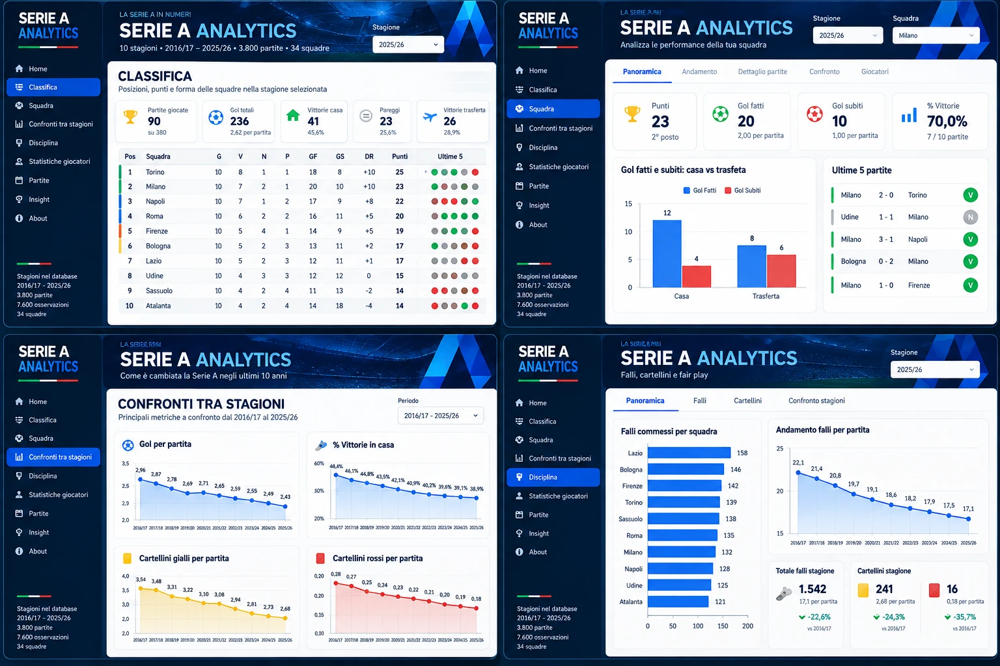

# Mockup del frontend Streamlit

File: [`mockup-streamlit.webp`](mockup-streamlit.webp). Creato dall'autore del progetto con uno strumento di generazione di immagini (2026-10-15).

## ⚠️ Cosa è e cosa non è
È un **riferimento visivo** (colori, disposizione, tipo di grafici). **Non è un risultato del progetto**: i numeri nell'immagine sono **inventati** e in più punti contraddicono i dati reali. Non va usato come screenshot né nel README.

| Nel mockup | Nei dati reali |
|---|---|
| Gol a partita in calo regolare (2,96 → 2,87 → 2,78 … → 2,43) | 2,96 → 2,68 → 2,68 → 3,04 → 3,05 → 2,87 → 2,56 → 2,61 → 2,56 → 2,43 |
| Gialli a partita da 3,54 a 2,68 | da 4,40 a 3,70, con picco di 5,09 nel 2019/20 |
| Falli a partita da 22,1 a 17,1 | da 27,93 a 25,35 |
| Classifica con "Torino 1° con 25 punti", "Milano", "Firenze" (stagione a metà) | nomi Milan e Fiorentina; solo stagioni complete (Inter 87 punti nel 2025/26) |

## Cosa riprendere nella fase 2 (veste grafica)
- Tema scuro blu/rosso/giallo e sidebar di navigazione.
- Schede KPI in alto (partite, gol totali, % vittorie in casa, pareggi, vittorie in trasferta).
- Tabella della classifica con la forma recente a pallini (ultime 5).
- Tab per sezione (Panoramica, Andamento…), grafici ad area con etichette.
- Confronti percentuali con la prima stagione del periodo.
- Pagine extra leggere: Home, Insight, About.

## Cosa NON si fa (fuori perimetro)
- **Statistiche e tab "Giocatori"**: il dataset non contiene dati sui giocatori.
- Marcature Champions / Europa / retrocessione nella classifica: non sono nei dati e le regole cambiano negli anni.
- Immagine di stadio nell'intestazione: servirebbe un'immagine con licenza libera; si usa un gradiente.
- Pagina "Partite" (elenco delle partite): rimandata.
